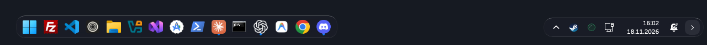
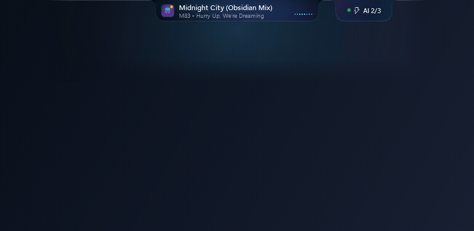
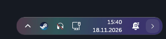

<div align="center">

# DinamikAda

**Native Windows 11 Dynamic Island, `explorer.exe` Floating Taskbar & Multi-Provider AI Quota HUD**

*Built in C# / .NET / WPF, Win32 P/Invoke, and native C++ Windhawk hooks for `explorer.exe` and `StartMenuExperienceHost`.*

[Türkçe Kullanım Kılavuzu](docs/kullanim.md) · [Quick Start](#quick-start) · [Build & Verify](#build-and-verify) · [Architecture](#architecture)

<br/>


<br/><br/>



</div>

---

## Feature Showcase

> *Note: If you have reduced motion enabled in your OS or GitHub settings, GitHub pauses GIF animations on the first frame — click any **Full-Size GIF** link to open the animation directly.*

### 1. Upper Dynamic Notch & 7-Tab Command Deck
Smooth morphing from the compact top media/AI telemetry pill into the 7-tab command deck (**Akış / Now**, **Ses / Audio**, **Denetim / Control**, **Raf / QR Shelf**, **Sistem / Telemetry**, **Araçlar / Tools**, **AI Kota**) and keyboard-driven **Command Palette** (`Ctrl+Shift+Space`).

<div align="center">
  
  <br/>
  <sub>Compact top pill expanding into all 7 Island modules and Command Palette — <a href="docs/screenshots/upper-island-motion.gif">Full-Size GIF</a></sub>
</div>

---

### 2. Multi-Account AI Quota & Subscription Telemetry
Track remaining usage windows across **ChatGPT / Codex** (`5h` + `Weekly`), **Claude**, **Google Antigravity** (3-pool model telemetry + OAuth sign-in), **Gemini CLI**, **Cursor**, **GitHub Copilot**, and custom API endpoints — persisted locally across restarts and surfaced directly in the top pill.

<div align="center">
  
  <br/>
  <sub>ChatGPT 5h + Weekly bars, Antigravity 3-pool breakdown, Claude cards, and Account Editor — <a href="docs/screenshots/ai-quota-showcase.gif">Full-Size GIF</a></sub>
</div>

---

### 3. Native `explorer.exe` Floating Taskbar & Collapsible System Tray
Instead of replacing Windows' taskbar shell with fragile overlays, DinamikAda enhances real `explorer.exe` using lightweight native Windhawk hooks (`GetWindowRgn` click-through around the visible islands, releasing the bottom work area for windows while keeping native Start menu, Jump Lists, and previews intact).

<table>
  <tr>
    <td width="64%" align="center">
      
      <br/>
      <sub><b>Explorer App Dock Cycle</b> — Bottom hover reveal, wave lift &amp; auto-conceal (<a href="docs/screenshots/explorer-dock-full-cycle.gif">Full-Size GIF</a>)</sub>
    </td>
    <td width="36%" align="center">
      
      <br/>
      <sub><b>Collapsible Tray</b> — One-click chevron tuck &amp; expand (<a href="docs/screenshots/explorer-tray.gif">Full-Size GIF</a>)</sub>
    </td>
  </tr>
</table>

---

### 4. Continuous Album-Art Color Sync Across Shell Surfaces
DinamikAda extracts the dominant palette from the playing track's artwork and writes smooth animated frame state to `%LOCALAPPDATA%\DinamikAda\ExplorerHost\animation-state.ini`, tinting the **Upper Island**, **`explorer.exe` App Dock**, **System Tray**, **Hidden Icons**, **Calendar & Notification flyouts**, **Quick Settings (`Win+A`)**, and **Windows 11 Start Menu (`StartMenuExperienceHost`)** together.

<div align="center">
  
  <br/>
  <sub>Synchronized album colors flowing across Top Island, Explorer App Dock, and System Tray — <a href="docs/screenshots/music-colors.gif">Full-Size GIF</a></sub>
</div>

<br/>

<div align="center">
  
  <br/>
  <sub>Windows 11 Start Menu (<code>StartMenuExperienceHost</code>) reactive album-art backdrop — <a href="docs/screenshots/music-start-menu.gif">Full-Size GIF</a></sub>
</div>

---

## Core Capabilities

| Surface | Highlights |
| :--- | :--- |
| **Upper Island** | Hardware-aligned top pill with live media artwork, focus timers, notification stream, per-app audio router, clipboard vault, file shelf + QR transfer, OCR, brightness controls, GPU/VRAM/CPU/Disk/Ping telemetry, color picker, and command palette (`Ctrl+Shift+Space`). |
| **Native `explorer.exe` Taskbar** | Five focused Windhawk modules (`ExplorerDockReveal`, `ExplorerTray`, `MusicGlass`, `StartMusicGlass`, and tray styling) keeping real Win11 pins, Jump Lists, and previews intact with zero bottom reserved band. |
| **AI Quota Tracker** | Multi-account monitoring for ChatGPT / Codex (`5h` & `Weekly`), Claude, Google Antigravity (`Gemini Models`, `Claude & GPT`, `Gemini 4 Argon` pools via OAuth), Gemini CLI, Cursor, Copilot, and custom JSON/API sources. |

---

## Quick Start

DinamikAda runs on **Windows 11 x64**. Building from source requires the **.NET 8 SDK**.

1. Clone the repository (or download and extract the ZIP from the **Code** menu) and launch:
   ```powershell
   .\DinamikAda-Baslat.bat
   ```
2. **Explorer Taskbar Setup:** Install [Windhawk](https://windhawk.net/) with its bundled compiler, exit DinamikAda from its notification-area icon, and run:
   ```powershell
   .\DinamikAda-Explorer-Kur.bat
   ```
3. Open **Settings → Bottom Dock (`Alt Dock`)** to toggle **Smart Auto-Hide** and icon hover behavior. Move the pointer to the **bottom center** to reveal the App Dock; click the rightmost arrow to collapse/expand the System Tray (**Win+A** opens Quick Settings).
4. Open the **AI Kota** tab in the Upper Island to connect ChatGPT, Claude, Antigravity (Google OAuth), Gemini CLI, Cursor, or custom providers.
5. To restore the default Windows taskbar at any time, exit DinamikAda and run:
   ```powershell
   .\DinamikAda-Windows-Barina-Don.bat
   ```

See [docs/kullanim.md](docs/kullanim.md) for the full Turkish usage & setup guide.

---

## Build and Verify

```powershell
# Build x64 Release solution
dotnet build DinamikAda.sln -c Release -p:Platform=x64

# Run test suite
dotnet test tests\DinamikAda.Tests\DinamikAda.Tests.csproj -c Release -p:Platform=x64

# Verify end-to-end launcher health (runs tests, publishes build, generates audit screenshots)
.\DinamikAda-Baslat.bat --verify

# Verify Explorer.exe Windhawk taskbar hooks and reveal/conceal cycle
powershell -NoProfile -ExecutionPolicy Bypass -File .\scripts\verify-explorer-taskbar.ps1 -RevealCycle

# Optional: register sparse MSIX identity for Windows Action Center notification mirroring
powershell -NoProfile -ExecutionPolicy Bypass -File .\scripts\register-sparse.ps1 -BinDir .\artifacts\app
```

---

## Architecture

- **`src/`** (`App`, `Core`, `Modules.*`, `Platform.Win32`) — Modular .NET WPF + Win32 P/Invoke host handling upper notch spring animation, multi-provider AI quota polling & persistence, media session / audio routing, system telemetry, and Explorer IPC state synchronization.
- **`native/`** — C++ Windhawk Explorer & `StartMenuExperienceHost` hook modules (`ExplorerDockReveal.hpp`, `ExplorerTray.hpp`, `MusicGlass.hpp`, `StartMusicGlass.hpp`) compiled & managed cleanly via `ExplorerTaskbarService`.
- **`tests/`** — .NET unit/layout/release-readiness tests and native C++ dock motion tests.

---

## License

- Managed C# / .NET codebase: [MIT License](LICENSE)
- Native Windhawk / Explorer C++ modules under `native/`: GNU General Public License v3.0 or later ([native/COPYING](native/COPYING))
