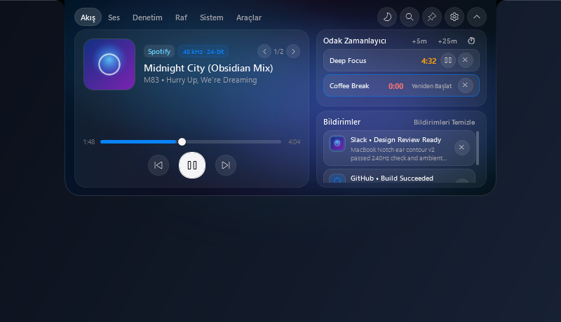
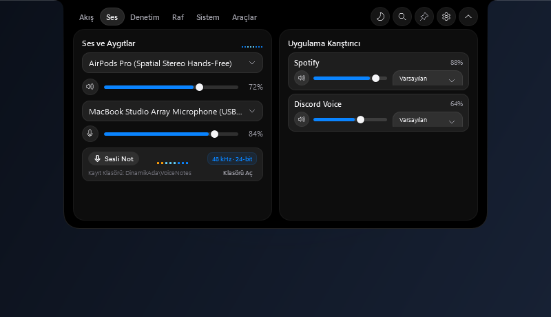
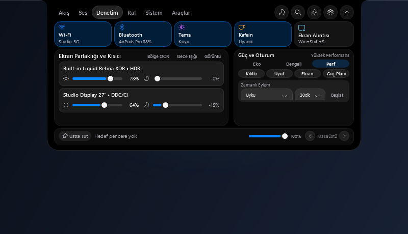

<div align="center">

# DinamikAda

**Native Windows 11 Dynamic Island Control Deck — built with C# 12, .NET 8, WPF & Direct Win32/COM/WinRT Interop.**


<br />



</div>

---

## Overview

**DinamikAda** is a zero-WebView, ultra-low-overhead Windows 11 top-notch / floating island workspace utility (`WPF` + `Win32` + `COM` + `WinRT`). It merges live media controls, macOS-style dynamic album ambient aura, per-app CoreAudio mixing, hardware & Night-Light-safe software brightness dimming, real OS telemetry, clipboard encryption vault, LAN QR file drops, region OCR, and a keyboard-driven command palette into a 240Hz-aligned layered island shell.

### Measured Runtime Characteristics (`--smoke-test`)
- **Zero WebView / Electron**: Pure WPF shell (`WebView2=False`) with native Win32/COM/WinRT hardware bridges.
- **Idle CPU**: **`0.018% – 0.055%`** (composition render loop automatically halts when settled or paused).
- **Motion Engine**: **`160 – 208 FPS`** measured render burst on 240Hz displays using pure `RenderTransform` / `PathGeometry` (zero layout invalidation during motion).
- **Automated Coverage**: **`109 / 109`** xUnit unit tests + headless GPU & software smoke checks + 30-frame automated render audit.

---

## Visual Showcase

<table>
  <tr>
    <td width="50%" align="center">
      
      <sub><b>S2 Compact Pill</b> — Soft album-derived ambient aura & audio bars</sub>
    </td>
    <td width="50%" align="center">
      
      <sub><b>S5 Command Hub</b> — Window switcher (@), vault (#), calc (=), shell (&gt;)</sub>
    </td>
  </tr>
  <tr>
    <td width="50%" align="center">
      
      <sub><b>Audio Tab</b> — WASAPI per-app mixer, endpoint routing & instant WAV voice notes</sub>
    </td>
    <td width="50%" align="center">
      
      <sub><b>Control Tab</b> — DDC/CI + Win32 WS_POPUP dimmer, caffeine & virtual desktops</sub>
    </td>
  </tr>
</table>

---

## Core Capabilities

- **Media & Dynamic Album Aura (`Modules.Media`)**: Windows GSMTC multi-session switcher, synced `.lrc` lyrics strip, CoreAudio mix-format probing (`SampleRate` / `BitDepth` switcher), per-app volume mixer & endpoint router, loopback spectrum visualizer, and instant WAV voice notes.
- **System & Display Control (`Modules.SystemControl` / `Platform.Win32`)**: DDC/CI hardware brightness + Night-Light-safe pure Win32 `WS_POPUP` (`UpdateLayeredWindow`) dimmer clamped to `0–75%`, Caffeine wake lock, scheduled sleep/shutdown timer, USB drive arrival/eject HUD, and monitor/virtual desktop window controls.
- **Real OS Telemetry & Maintenance (`Modules.Telemetry`)**: PDH / DXGI / AMD ADL real-time CPU, GPU engine/VRAM/temp, RAM, disk I/O, network rates, `1.1.1.1` ICMP latency, hung process watchdog, safe `%TEMP%` cleanup, memory trim, and idle background app scanner.
- **Productivity & Capture (`Modules.Productivity`)**: File shelf with drag-out & non-destructive EXIF strip/compress, DPAPI-encrypted clipboard vault, region screenshot + `Windows.Media.Ocr`, screen eyedropper color picker, local LAN Drop HTTP QR file transfer, and `.ics`/webcal meeting countdown.
- **Command Palette & Developer Bridge (`Modules.CommandHub`)**: Global hotkey launcher (`Ctrl+Shift+Space`), fuzzy search prefixes (`@`, `#`, `=`, `>`, `/`), C# widget plugin host, and local HTTP (`127.0.0.1:47821`) / Named Pipe automation bridge.

---

## Modular Solution Architecture

```text
DinamikAda.sln
├── src/
│   ├── DinamikAda.Core                  # Shared contracts, arbitration state machine, localization, config
│   ├── DinamikAda.Platform.Win32        # Low-level P/Invoke, hotkeys, monitor DPI math, WS_POPUP dimmer, fullscreen detection
│   ├── DinamikAda.Modules.Media         # GSMTC, CoreAudio COM/WASAPI, spectrum FFT, LRC lyrics, WAV notes
│   ├── DinamikAda.Modules.SystemControl # DDC/CI brightness, network/power state, USB arrival/eject
│   ├── DinamikAda.Modules.Telemetry     # Real CPU/GPU/VRAM/Disk/Net counters, ICMP ping, OS cleanup
│   ├── DinamikAda.Modules.Productivity  # File shelf, EXIF cleaner, DPAPI clipboard, OCR, QR LAN transfer, iCalendar
│   ├── DinamikAda.Modules.Notifications # Windows Action Center notification mirroring & modal viewer
│   ├── DinamikAda.Modules.Widgets       # Isolated custom widget host with circuit breaker
│   ├── DinamikAda.Modules.CommandHub    # Fuzzy command palette, window snapping, localhost Developer Bridge
│   └── DinamikAda.App                   # WPF layered island shell, 240Hz motion engine & orchestrator
└── tests/
    └── DinamikAda.Tests                 # 109 xUnit unit & integration tests
```

---

## Build, Run & Verification

### Requirements
- Windows 11 (`x64`)
- .NET 8 SDK (`net8.0-windows10.0.26100.0` targeting)

### Commands
```powershell
# Restore & build Release|x64
dotnet build DinamikAda.sln -c Release -p:Platform=x64 -m

# Run unit tests (109 tests)
dotnet test tests\DinamikAda.Tests\DinamikAda.Tests.csproj -c Release -p:Platform=x64 --no-build --verbosity normal

# Publish standalone output to .\artifacts\app\
powershell -NoProfile -ExecutionPolicy Bypass -File .\scripts\build.ps1

# Launch application
.\artifacts\app\DinamikAda.App.exe
```

### Automated Verification Harnesses
```powershell
# Headless GPU & software smoke checks (IdleCpuPct < 0.5%)
.\artifacts\app\DinamikAda.App.exe --smoke-test --duration-sec 6 --trace
.\artifacts\app\DinamikAda.App.exe --smoke-test --sw --duration-sec 5 --trace

# Offline 30-frame WPF render audit
.\artifacts\app\DinamikAda.App.exe --render-audit .\render_audit
```

### Optional Sparse MSIX Notification Identity
To mirror Windows Action Center notifications via `UserNotificationListener`, register the optional local Sparse MSIX identity using Windows SDK (`makeappx.exe` & `signtool.exe`):
```powershell
powershell -NoProfile -ExecutionPolicy Bypass -File .\scripts\register-sparse.ps1 -BinDir .\artifacts\app
```

---

## License

Licensed under the [MIT License](LICENSE).
