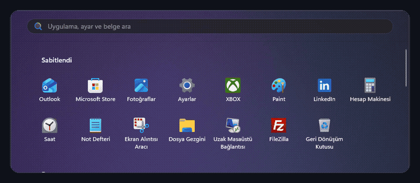

# DinamikAda kullanım kılavuzu

## İlk açılış

1. GitHub’da **Code → Download ZIP** ile projeyi indirip çıkar veya depoyu klonla.
2. Windows 11 x64 üzerinde .NET 8 SDK’yı kur ve **DinamikAda-Baslat.bat** dosyasını aç. İlk çalıştırmada uygulama derlenir.
3. Üst adaya tıklayarak medya, ses, sistem ve **AI Kota** sekmelerini aç. Komut paleti kısayolu **Ctrl+Shift+Space**.
4. **Ayarlar → Alt Dock** bölümünden alt bar modunu seç. Değişiklikler için **Kaydet**’e bas.

## Explorer görev çubuğu

1. [Windhawk](https://windhawk.net/) ve beraberindeki derleyici kurulu olsun.
2. DinamikAda açıksa bildirim alanındaki simgesinden **Çıkış**’ı seç. Ardından **DinamikAda-Explorer-Kur.bat** dosyasını çalıştır.
3. **Ayarlar → Alt Dock** bölümünde **Windows’un kendi görev çubuğunu DinamikAda tasarımıyla kullan** seçeneğini kontrol et. Aynı ekrandan **Akıllı Gizleme** ve simge büyütmeyi ayarlayabilirsin.
4. Pencere büyütülüyken fareyi **ekranın tam alt ortasına** götür. Uygulama sırası açılır. Bir simgenin üzerine geldiğinde simge hafifçe yükselir.
5. Sağ uçtaki oka tıklayarak sistem tepsisini küçült. Aynı düğme tepsiyi geri açar. Gizli simgelere erişmek için önce tepsiyi aç. Ses ayarı için **Win+A** kullan.

[Dock GIF’ini aç](https://raw.githubusercontent.com/escompanystudio-base/DinamikAda/main/docs/screenshots/explorer-dock-full-cycle.gif)

### Müziğe göre renk geçişi

DinamikAda, Windows medya oturumunun paylaştığı albüm kapağından renkleri alır. Yeni kapak gecikirse üst ada önceki paleti kısa süre korur ve kapak geldiğinde yeni renklere yumuşakça geçer. AI kapsülü ve açık ada sekmeleri de aynı paleti kullanır.

Explorer modunda renkler alt dock, sistem tepsisi, gizli simgeler, Başlat menüsü, bildirim ve takvim panelleri ile Hızlı Ayarlar’a da yansır.

### Explorer modunu güncelleme

- Son kodu indir veya **git pull** çalıştır. DinamikAda’dan çık ve **DinamikAda-Windows-Barina-Don.bat** dosyasını çalıştır. Ardından **DinamikAda-Explorer-Kur.bat** ile yerel bileşenleri derle ve modu yeniden etkinleştir.
- Windhawk özel bir dizindeyse PowerShell’den aşağıdaki komutları çalıştır. İlk komuttaki dizini kendi kurulum yolunla değiştir.

~~~powershell
powershell -NoProfile -ExecutionPolicy Bypass -File .\scripts\setup-explorer-taskbar.ps1 -WindhawkDirectory "D:\Apps\Windhawk"
.\DinamikAda-Baslat.bat --explorer-taskbar
~~~

- Windows güncellemesinden sonra görünüm veya açılma bozulursa **DinamikAda-Windows-Barina-Don.bat** ile standart bara dön. Uyumlu bir DinamikAda sürümü geldiğinde Explorer kurulumunu yeniden çalıştır.
- DinamikAda’nın ayrı dock’una geçmek için **Ayarlar → Alt Dock** bölümünde Explorer modunu kapatıp dock’u etkinleştir.

## AI Kota ve birden fazla hesap

1. Üst adayı aç, **AI Kota** sekmesine gir ve sağlayıcının **Ekle** düğmesine bas.
2. Her hesap için ayrı kart aç. Tarayıcı eski oturumu öneriyorsa **başka bir hesap kullan** seçeneğiyle doğru hesabı seç.
3. Karttaki hesap adresini ve veri kaynağını kontrol et. Bir hesap ikinci kez görünüyorsa veya giriş başka bir hesaba aitse ilgili karttaki **Yeniden bağla** düğmesini kullan.
4. **ChatGPT / Codex** kartında sağlayıcının döndürdüğü 5 saatlik ve haftalık Codex kotasını ve yenilenme zamanlarını ayrı ayrı görebilirsin.
5. **Claude** kartında canlı ölçüm için uyumlu bir Claude Code oturumu gerekir. Karttaki kullanım simgesi tarayıcıda Claude kullanım sayfasını açar.
6. **Antigravity** kartındaki model havuzlarını ayrı ayrı kontrol et. Kayıtlı veri gösteriliyorsa son ölçüm zamanı kartta yer alır.

## Genel kontroller

| İşlem | Nereden ulaşılır |
| --- | --- |
| Oynatma ve medya oturumu seçme | Üst ada → Şimdi |
| Uygulama sesini ve çıkış aygıtını ayarlama | Üst ada → Ses |
| Parlaklık, güç ve uyku ayarları | Üst ada → Kontrol |
| Uygulama veya açık pencere arama | **Ctrl+Shift+Space** |
| Standart Windows görev çubuğunu geri getirme | DinamikAda’dan çık → **DinamikAda-Windows-Barina-Don.bat** |

[Proje ana sayfası](../README.md)
