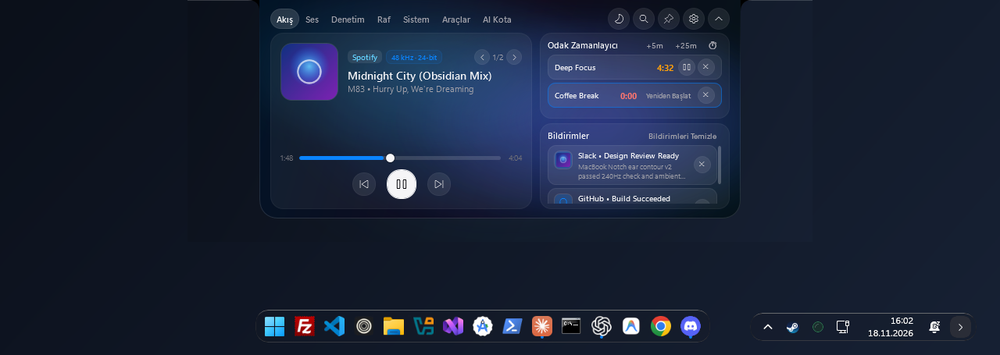
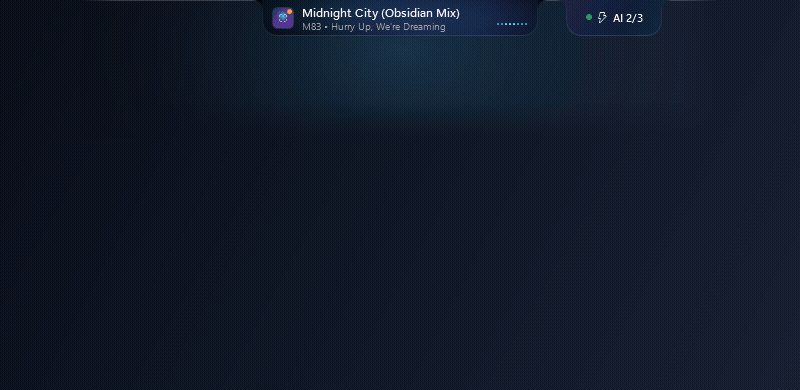
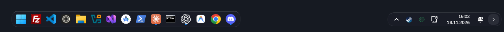
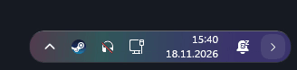
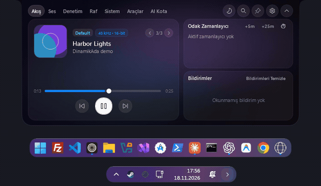
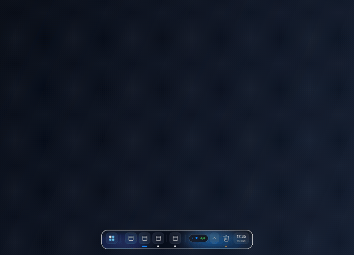

# DinamikAda — Kullanım ve Mimari Kılavuzu

[English README](../README.md) · [Hızlı Başlangıç](#h%C4%B1zl%C4%B1-ba%C5%9Flang%C4%B1%C3%A7) · [Özellik Turu](#%C3%B6zellik-turu) · [Explorer.exe Görev Çubuğu](#explorerexe-g%C3%B6rev-%C3%A7ubu%C4%9Fu-modu) · [AI Kota](#ai-kota--abonelik-takibi)

<div align="center">
  
</div>

DinamikAda; Windows 11 üzerinde üst **Dinamik Ada (MacBook Notch)** deneyimini, gerçek **`explorer.exe` yüzer görev çubuğu** yamalarını ve çok hesaplı **AI Kota** takibini tek bir native çatı altında birleştirir.

---

## Özellik Turu

> *Not: İşletim sisteminizde veya GitHub ayarlarında "Azaltılmış Hareket" (Reduced Motion) açıksa GitHub GIF'leri ilk karede duraklatabilir — animasyonu tam boy izlemek için altındaki **GIF'i Tam Boyut Aç** bağlantısına tıklayabilirsiniz.*

### 1. Üst Dinamik Ada (7 Sekme + Komut Paleti)
Kompakt medya/AI kapsülünden pürüzsüz yay animasyonuyla açılan 7 sekmeli komuta merkezi (**Akış**, **Ses**, **Denetim**, **Raf / QR**, **Sistem**, **Araçlar**, **AI Kota**) ve klavye odaklı **Komut Paleti**.

<div align="center">
  
  <br/>
  <sub><a href="./screenshots/upper-island-motion.gif">GIF'i Tam Boyut Aç</a></sub>
</div>

- **Akış:** Canlı Spotify/sistem medyası, `48 kHz · 24-bit` kaynak bilgisi, kaynak değiştirici (`< 1/2 >`), **Odak Zamanlayıcı** (`+5m` / `+25m`) ve etkileşimli Windows bildirim akışı.
- **Ses:** Uygulama bazlı ses mikseri ve tek tıkla ses çıkış aygıtı yönlendirmesi.
- **Denetim & Araçlar:** Hızlı sistem anahtarları, zamanlanmış kapatma/yeniden başlatma sayacı, USB kısayolu ve anlık ekran **Renk Seçici (Color Picker)** HUD bildirimleri.
- **Raf & QR:** Sürükle-bırak geçici dosya rafı ve tek tıkla QR kod ile paylaşım.
- **Sistem:** Canlı CPU, RAM, GPU (`VRAM`, sıcaklık, fan hızı), Ağ hızı, Disk I/O, `1.1.1.1` ping ölçümü, RAM/Disk temizleme ve yanıt vermeyen süreç yönetimi.

---

### 2. AI Kota & Çoklu Hesap Takibi
Tek bir sekmeden tüm yapay zeka aboneliklerinizi gerçek zamanlı izleyin:
- **ChatGPT:** `5 saatlik` ve **Haftalık (`7g`)** kalan kota barları ve net yenilenme saatleri.
- **Google Antigravity:** Tek tık **Google OAuth** girişi + **Gemini Models**, **Claude & GPT** ve **Gemini 4 Argon** havuzlarının `5s` + `7g` ayrı kırılımları.
- **Claude, Gemini CLI, Cursor, GitHub Copilot ve Özel API:** Birden fazla hesabı etiketleyin, kritik eşik uyarısı (%) belirleyin ve verileri PC yeniden başlatsanız bile lokalde kalıcı olarak koruyun.

<div align="center">
  
  <br/>
  <sub><a href="./screenshots/ai-quota-showcase.gif">GIF'i Tam Boyut Aç</a></sub>
</div>

---

### 3. `explorer.exe` Görev Çubuğu Modu (Windhawk)

<div align="center">
  
</div>

- DinamikAda kendi sahte görev çubuğu yerine **gerçek Windows 11 `explorer.exe`** görev çubuğunu iki yüzer adaya (ortada **App Dock**, sağda **Sistem Tepsisi**) böler; arada kalan alanlar `GetWindowRgn` ile alt pencerelere tıklamayı ve pencere önizlemelerini sorunsuz iletir.
- Alt kenardaki 48 px çalışma alanı kilidini kaldırır; pencereler ekranı tam boy kullanır, fare alt kenara geldiğinde dock akıcı şekilde yükselir (`Auto-Reveal`) ve uzaklaştığınızda gizlenir.
- İkon üzerine gelindiğinde dalga efekti (`wave lift`) ve yerel Windows araç ipuçları çalışmaya devam eder.
- Sağ taraftaki Sistem Tepsisi daraltma oku (`<` / `>`) ile gereksiz mikrofon/ses simgelerini gizleyip sadeleştirebilirsiniz.

<table>
  <tr>
    <td width="64%" align="center">
      
      <br/>
      <sub>App Dock tam döngü (<a href="./screenshots/explorer-dock-full-cycle.gif">GIF'i Tam Boyut Aç</a>)</sub>
    </td>
    <td width="36%" align="center">
      
      <br/>
      <sub>Tepsi daralt/genişlet (<a href="./screenshots/explorer-tray.gif">GIF'i Tam Boyut Aç</a>)</sub>
    </td>
  </tr>
</table>

---

### 4. Kesintisiz Albüm Kapağı Rengi (Ada + Görev Çubuğu + Başlat Menüsü)
Çalan müziğin baskın kapak renkleri gerçek zamanlı örneklenir ve `%LOCALAPPDATA%\DinamikAda\ExplorerHost\animation-state.ini` üzerinden yerel Windows kabuğuna aktarılır:
- **Üst Ada**, **Explorer App Dock**, **Sistem Tepsisi** ve **Windows 11 Başlat Menüsü (`StartMenuExperienceHost`)** şarkı değiştikçe aynı renk paletiyle nefes alır.

<div align="center">
  
  <br/>
  <sub><a href="./screenshots/music-colors.gif">GIF'i Tam Boyut Aç</a></sub>
</div>

<br/>

<div align="center">
  
  <br/>
  <sub>Windows 11 Başlat Menüsü senkronizasyonu (<a href="./screenshots/music-start-menu.gif">GIF'i Tam Boyut Aç</a>)</sub>
</div>

---

### 5. Bağımsız Alt Dock, Başlat Launcher ve Açılır Pencereler
Explorer modu dışında veya özel düzenlerde kullanılabilen bağımsız **Alt Dock**, uygulama arayıcılı **Başlat Launchpad**, entegre **Takvim**, **Arka Plan Uygulamaları** tepsisi ve detaylı **Ayarlar** penceresi.

<div align="center">
  
  <br/>
  <sub><a href="./screenshots/standalone-dock-launchpad.gif">GIF'i Tam Boyut Aç</a></sub>
</div>

---

## Hızlı Başlangıç

1. Projeyi başlatmak için kök dizindeki başlatıcıyı çalıştırın:
   ```powershell
   .\DinamikAda-Baslat.bat
   ```
2. **Ayarlar -> Görev Çubuğu & Dock** bölümünden **Explorer.exe Doğal Ada (Windhawk)** modunu etkinleştirin veya bağımsız dock modunu seçin.
3. Kurulum sonrası doğrulama ve Explorer döngü testi için:
   ```powershell
   .\DinamikAda-Baslat.bat --verify
   .\scripts\verify-explorer-taskbar.ps1 -RevealCycle
   ```
4. Varsayılan Windows görev çubuğuna istediğiniz an geri dönmek için Ayarlar içinden modu kapatmanız yeterlidir; çalışma alanı (`SPI_SETWORKAREA`) otomatik olarak geri yüklenir.

---

## AI Kota & Hesaplar

- **Kalıcı Kayıt:** Eklenen tüm hesaplar, etiketler, eşikler ve son senkronize kullanım değerleri yerel uygulama veri klasöründe saklanır; DinamikAda kapatılıp açıldığında veya PC yeniden başlatıldığında kaybolmaz.
- **Google Antigravity OAuth:** Düzenle / Ekle penceresindeki **Google (Antigravity) ile Giriş Yap** düğmesi doğrudan tarayıcıda OAuth akışını başlatır ve bağlanan gerçek hesabı kartla eşleştirir.
- **Üst Kapsül Özeti:** Aktif seçili AI hesaplarınız üst adadaki kompakt kapsülde anlık yeşil/sarı/kırmızı yüzde durumu ile görünür.
